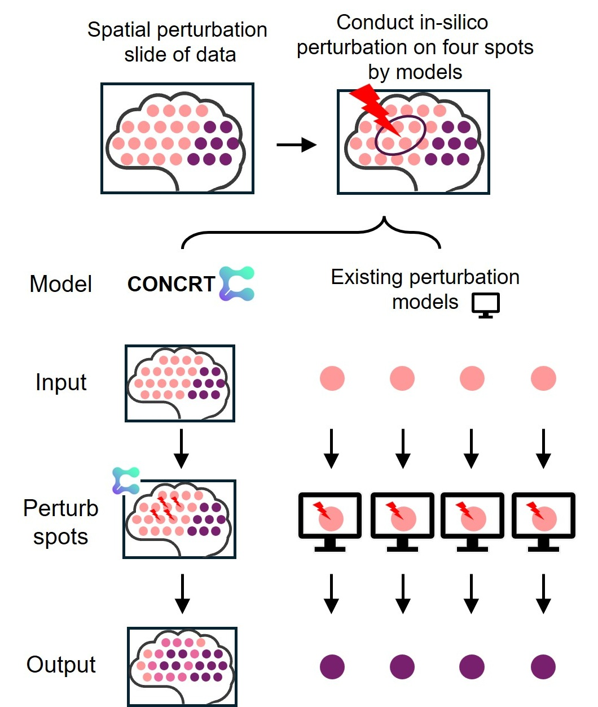
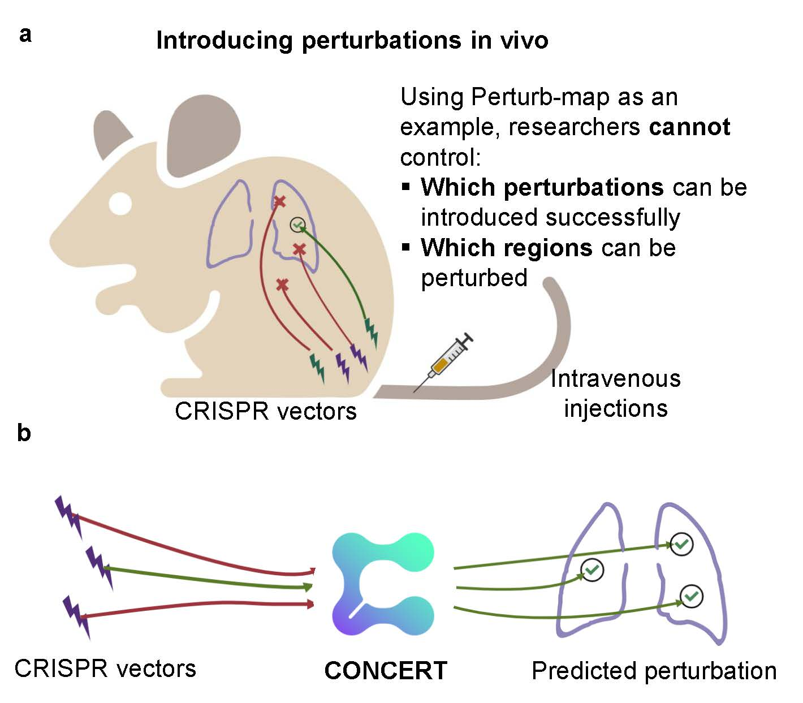
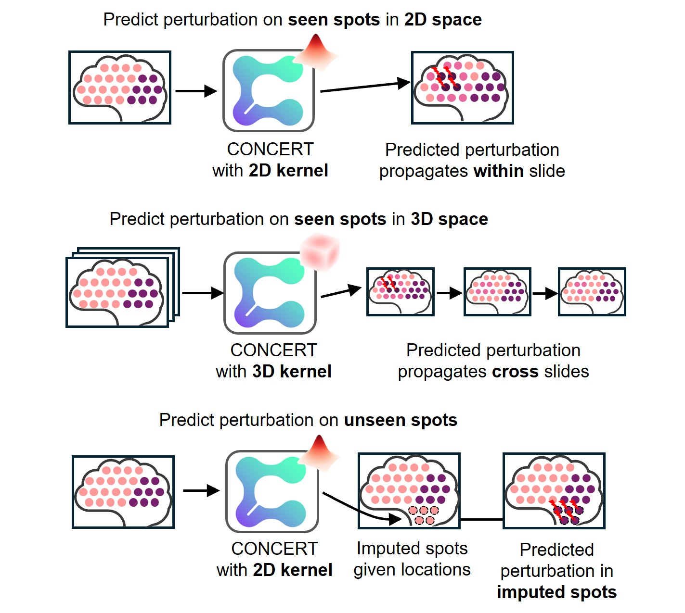

# CONCERT predicts niche-aware perturbation responses in spatial transcriptomics

[](https://zitniklab.hms.harvard.edu/projects/CONCERT/) [](https://www.biorxiv.org/content/early/2025/11/10/2025.11.08.686890) [](https://github.com/mims-harvard/CONCERT/) [](./datasets/) [](./notebooks/) 

Xiang Lin, [Zhenglun Kong](https://scholar.google.com/citations?hl=en&user=XYa4NVYAAAAJ), [Soumya Ghosh](https://scholar.google.com/citations?user=GEYQenQAAAAJ&hl=en), [Manolis Kellis](https://scholar.google.com/citations?user=lsYXBx8AAAAJ&hl=en), [Marinka Zitnik](https://scholar.google.com/citations?user=YtUDgPIAAAAJ&hl=en)

Spatial perturbation transcriptomics measures how genetic or chemical edits alter gene
expression while preserving tissue context. Perturbation outcomes depend on a cell's intrinsic
state and also on how effects propagate across cellular microenvironments. **CONCERT** is a
niche-aware generative model that embeds perturbation context and learns spatial kernels with a
Gaussian-process variational autoencoder to predict perturbation effects across tissue. Each
perturbation is given a spatial effect field over the section and a gain that controls how
strongly the local microenvironment may reshape its response, so the same perturbation can
produce different responses in different neighbourhoods. A temporal variant extends the same
construction over time, so one model covers a whole time course and can be asked for a
timepoint it was never trained on.

We formalise two prediction tasks: **within-niche prediction**, where a cell's response to a
perturbation carried by cells of its own local niche is predicted, and **cross-slide
prediction**, where the response must be transferred to a slide on which that perturbation was
never observed. CONCERT is evaluated on a SPAC-seq screen of hundreds of knockouts and on
Perturb-map lung tumour sections, and outperforms dissociated counterfactual models, spatial
perturbation models and neighbour-averaging strategies on both the magnitude and the gene
ranking of the predicted response. Two case studies go beyond benchmarking: in DSS-induced
colitis CONCERT reconstructs expression at unmeasured timepoints and recovers the non-monotone
course of the injury, rising to a day-9 peak and resolving by day 21, which interpolation
between observed timepoints cannot produce; in ischemic stroke it predicts responses under
lesion sizes and 3D geometries that photothrombosis cannot produce experimentally.

## ⚡ Challenges from existing perturbation models

Ignoring cells' tissue context when predicting perturbations

<p align="center">
  
</p>

## 🔥 Challenges from existing spatial perturbation sequencing technologies

<p align="center">
  
</p>

## 🛠️ Functions of CONCERT

1. Predict perturbations on cells considering their niches (2D or 3D).
2. Predict perturbations across slides, including perturbations never seen on the target slide.
3. Predict perturbations at timepoints that were never measured.
4. Impute missing cells with perturbation prediction.
5. Learn the scope of a perturbation's effect on tissue space.
6. Disentangle perturbation effects - intra- or inter-cellular.

<p align="center">
  
</p>

## 🗂️ Repository layout

| Path | Contents |
|---|---|
| [`models/concert_benchmark/`](./models/concert_benchmark/) | Model used for the SPAC-seq and Perturb-map benchmarks |
| [`models/concert_temporal/`](./models/concert_temporal/) | Model used for the colitis time-course case study |
| [`models/concert_spac_niche/`](./models/concert_spac_niche/) | Model used for the stroke case study |
| [`benchmark_evaluation/`](./benchmark_evaluation/) | Scoring code shared by the two benchmark experiments |
| [`experiments/`](./experiments/) | One directory per experiment: data preparation, training, evaluation, figures |
| [`reproduction/`](./reproduction/) | Reproducing the paper: one script per result, with its own README |
| [`notebooks/`](./notebooks/) | The same four results as step-by-step tutorials, with figures |
| [`datasets/`](./datasets/) | Where every dataset comes from, and how to point the code at it |
| [`config/paths.sh`](./config/paths.sh) | Data, output and environment paths - the one file the SLURM scripts read |

The three model directories are deliberate copies rather than one shared package. They diverged
in the model source itself, not only in configuration, and keeping them separate means a change
made for the time course cannot silently alter a benchmark number.

## ⚙️ Dependencies

Python 3.11.13 and one CUDA GPU for training and for the prediction steps; the figure and
table steps run on CPU. The reported results were produced in this environment:

```
torch==2.3.0          # CUDA 11.8 build
numpy==1.26.4
scipy==1.12.0
pandas==2.3.3
scikit-learn==1.8.0
scanpy==1.10.1
anndata==0.12.2
h5py==3.13.0
matplotlib==3.10.1
scvi-tools==1.3.3
wandb==0.22.1
```

```bash
conda create -n concert_env python=3.11 && conda activate concert_env
pip install torch==2.3.0 --index-url https://download.pytorch.org/whl/cu118
pip install -r env_requirements.txt
```

CUDA 11.8 supports up to `sm_90`, so this environment **cannot run on Blackwell GPUs** - a run
that dies with an `nvrtc -arch` error a few minutes in was scheduled on one. Ask for an H100 or
an A100.

## 💻 Run CONCERT

### Getting started

1. Create the environment from `env_requirements.txt`.
2. Download the two input folders, `data/` and `checkpoints/` (link to be added), and place both
   in the repository root:

   ```
   CONCERT/
     data/           sections, benchmark assets, shipped results
     checkpoints/    one directory per trained model
     runs/           created on first use: where reruns write
   ```

   Every notebook, script and SLURM runner finds them there. To keep them elsewhere, set
   `CONCERT_DATA_DIR`, `CONCERT_CHECKPOINT_ROOT` and `CONCERT_WORKDIR`.
   [`datasets/README.md`](./datasets/README.md) describes both folders; `data/README.md` lists
   every file and the notebook or script that reads it.
3. Check the wiring. Every script prints an existence table for each input it needs and stops
   on the first missing one:

   ```bash
   python reproduction/01_spac_seq_benchmark.py --steps aggregate
   ```

### Example 1 - train on a spatial perturbation dataset

Each dataset has one configuration file with every model setting of the reported runs. A run
names the configuration, the data and the output directory:

| Dataset | Configuration file | Training script | Trained checkpoint |
|---|---|---|---|
| SPAC-seq | `models/concert_benchmark/configs/spacseq.yaml` | `experiments/01_spac_seq_benchmark/train/train.sh` | `checkpoints/spacseq_within_niche`, `checkpoints/spacseq_cross_slide` |
| DSS colitis | `models/concert_temporal/configs/dss.yaml` | `experiments/03_dss_gut_case_study/train/train.sh` | `checkpoints/dss_colitis` |
| Perturb-map | `models/concert_benchmark/configs/perturbmap.yaml` | `experiments/02_perturb_seq_benchmark/train/train.sh` | `checkpoints/perturbmap_within_niche`, `checkpoints/perturbmap_cross_slide` |

**SPAC-seq** (five sections, within-niche setting):

```bash
cd models/concert_benchmark
python run_concert_spac.py --config configs/spacseq.yaml --stage train \
  --multi_sample_files $(ls $CONCERT_DATA_DIR/spacseq/raw/raw_output_1-*.h5ad | paste -sd,) \
  --holdout_file $CONCERT_DATA_DIR/benchmark_assets/holdout_coords/holdout_spac_seen.json \
  --outdir $CONCERT_WORKDIR/spacseq_within_niche
```

**DSS colitis** (all sections of the time course, in the order of `manifest.csv`):

```bash
cd models/concert_temporal
python run_concert_spac.py --config configs/dss.yaml --stage train \
  --multi_sample_files $(awk -F, -v d=$CONCERT_DATA_DIR/dss_colitis/sections 'NR>1{print d"/"$1}' \
      $CONCERT_DATA_DIR/dss_colitis/sections/manifest.csv | paste -sd,) \
  --arch_desc_dir $CONCERT_DATA_DIR/dss_colitis/architecture \
  --outdir $CONCERT_WORKDIR/dss_colitis
```

**Perturb-map** uses the same command with `configs/perturbmap.yaml`.

Training writes `model.pt` **and** `pert_map.json` into `--outdir`; the perturbation vocabulary
is read from `pert_map.json` at evaluation, so the integer code of every perturbation matches the
one the weights were trained with. Any flag on the command line overrides the file.

The training scripts in the table are the commands of the reported runs:

```bash
sbatch experiments/01_spac_seq_benchmark/train/train.sh seen
sbatch experiments/03_dss_gut_case_study/train/train.sh
sbatch experiments/02_perturb_seq_benchmark/train/train.sh seen
```

### Example 2 - counterfactual prediction on chosen spots

Give a file of spot indices and the perturbation to apply. Spots can be selected interactively
with the Shiny app in [`select_cells/`](./select_cells/). The example knocks out *Stat1* in the
chosen spots of the trained SPAC-seq model; `__KEEP__` leaves each spot in its own tissue.

```bash
cp -r $CONCERT_CHECKPOINT_ROOT/spacseq_within_niche $CONCERT_WORKDIR/   # prediction writes next to model.pt
cd models/concert_benchmark
python run_concert_spac.py --config configs/spacseq.yaml --stage eval \
  --multi_sample_files $(ls $CONCERT_DATA_DIR/spacseq/raw/raw_output_1-*.h5ad | paste -sd,) \
  --outdir $CONCERT_WORKDIR/spacseq_within_niche \
  --pert_cells spots.txt --target_cell_tissue __KEEP__ --target_cell_perturbation Stat1
```

Use the configuration file the model was trained with: it carries the lengthscale band of the
spatial field, which is a plain attribute rather than a saved weight.

The decoder is

```
log mu = f_basal(x, expression) + 1[has_guide] * mu_action + 1[is_real_KO] * f_pert(g, x)
```

so a decode to perturbation `g` and a decode to the basal slot differ by exactly the
perturbation terms - the basal reconstruction cancels. Every reported score is computed on that
difference of two decodes, not on one decode alone.

### Example 3 - imputation and counterfactual prediction in a missing patch

CONCERT fills in a patch of tissue that is missing from a slide, and predicts what the missing
cells would look like under a perturbation. Train on the slide without the patch, then run
`--stage impute_patch` with a mask file naming the missing cells. Each missing cell is predicted
at its own coordinates from the surrounding tissue: cells of the unperturbed group are imputed
as they are, and cells of a knockout group are imputed together with the counterfactual effect
of that knockout at their location.

```bash
cd models/concert_benchmark
python run_concert_spac.py --config configs/spacseq.yaml --stage train \
  --data_file slide_missing_patch.h5ad --outdir $CONCERT_WORKDIR/impute_demo
python run_concert_spac.py --config configs/spacseq.yaml --stage impute_patch \
  --data_file slide_missing_patch.h5ad --outdir $CONCERT_WORKDIR/impute_demo \
  --mask_index_file patch_mask.npz --raw_slide_file slide_full.h5ad
```

`patch_mask.npz` holds three arrays over the cells of the full slide: `obs_name` (cell id),
`group` (perturbation label) and `role` (1 for a missing cell). The run writes
`impute_results.npz` with the predicted and the measured expression of every missing cell.
[`experiments/08_deconvolution_imputation`](./experiments/08_deconvolution_imputation/) builds
the mask and the masked slide for the SPAC-seq patch experiment of the paper and compares
CONCERT with Tangram, SpatialScope and SpaIM.

### Naming

The code paths, output directories and CSV columns use `seen` and `unseen`. In the manuscript
those two settings are **within-niche prediction** and **cross-slide prediction**.

## 🔁 Reproducing the paper

Everything needed to reproduce the reported results is in [`reproduction/`](./reproduction/),
with its own [README](./reproduction/README.md): one script per result, the step-by-step
notebooks with their figures, and the end-to-end experiment pipelines.

## 🗃️ Datasets

No data is included in this repository. Every dataset is linked, with the processed copies the
code reads, in [`datasets/README.md`](./datasets/README.md).

| Dataset | Raw data | Processed data |
|---|---|---|
| [SPAC-seq CRISPR screen](https://doi.org/10.1016/j.cell.2026.04.049) | *pending release* | *pending release* |
| [Perturb-Map](https://www.cell.com/cell/fulltext/S0092-8674(22)00195-7) | [GEO GSE193460](https://www.ncbi.nlm.nih.gov/geo/query/acc.cgi?acc=GSE193460) | [Figshare](https://figshare.com/articles/dataset/Datasets_-_Perturb-Map/29198468) |
| [Colitis MERFISH time course](https://doi.org/10.1016/j.cell.2024.03.013) | *pending release* | *pending release* |
| [Colon inflammation](https://www.nature.com/articles/s41586-024-08216-z) | [Broad SCP2771](https://singlecell.broadinstitute.org/single_cell?type=study&page=1&terms=SCP2771) | [Figshare](https://figshare.com/articles/dataset/Mouse_gut_inflammation_dataset/29882873) |
| [Brain stroke](https://www.science.org/doi/abs/10.1126/scitranslmed.adg1323) | From the authors of the original paper on request | [Figshare](https://figshare.com/articles/dataset/Mouse_brain_stroke_dataset/29882900) |

The trained checkpoints are one downloadable folder, `checkpoints/`, with one subdirectory per
model; [`datasets/README.md`](./datasets/README.md#trained-checkpoints) lists them and gives the
download command. Every result can also be regenerated from the scripts.

## ⚖️ License

The code in this package is licensed under the MIT License. See [`LICENSE`](./LICENSE).

## 📝 Reference

```bibtex
@article{Lin2025.11.08.686890,
  author  = {Lin, Xiang and Kong, Zhenglun and Ghosh, Soumya and Kellis, Manolis and Zitnik, Marinka},
  title   = {CONCERT predicts niche-aware perturbation responses in spatial transcriptomics},
  elocation-id = {2025.11.08.686890},
  year    = {2025},
  doi     = {10.1101/2025.11.08.686890},
  publisher = {Cold Spring Harbor Laboratory},
  URL     = {https://www.biorxiv.org/content/early/2025/11/10/2025.11.08.686890},
  journal = {bioRxiv}
}
```

## 💬 Questions

Please leave a GitHub issue or contact Xiang Lin or
[Marinka Zitnik](mailto:marinka@zitnik.si).
