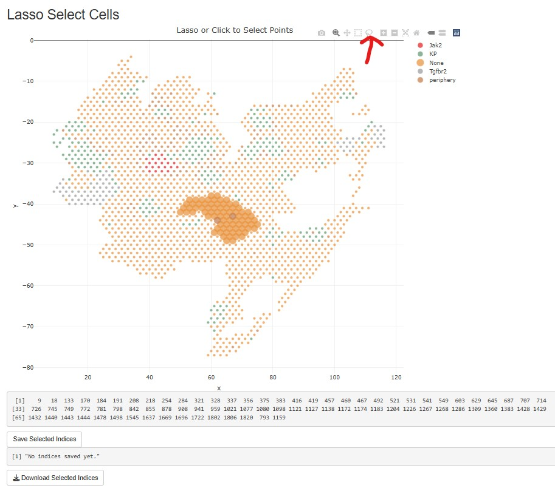

## App to select cells/spots for in-silico perturbation

`select_cells.R` is a Shiny app that plots a section and lets you select spots with single clicks
or the lasso tool. The selected spot indices are saved to a text file, one index per line, which
the CONCERT evaluation stage reads through `--pert_cells`.

  

Example files used in the experiments:
1. `pert_cells_GSM5808054_patchclose_tumor_Jak2.txt` - unperturbed tumour spots of Perturb-map section GSM5808054 that receive the Jak2 knockout in silico;
2. `pert_cells_stroke_sham1_CIA.txt` - spots of the sham section 1 that receive the stroke lesion in silico;
3. `GSM5808055_impute_region2.txt` - x and y coordinates of the spots of a region of Perturb-map section GSM5808055, selected for imputation.

The Perturb-map case study (`experiments/05_perturb_seq_case_study/evaluation/case_study.py`) reads its
patch selections from this folder: `pert_cells_GSM5808054_patchclose_tumor_Jak2.txt`,
`patch_trans.txt`, `GSM5808054_patch_tumor_tgfbr2_both.txt` and `GSM5808054_border_peri.txt`.
